# Sistemas de Informação | UFV - CRP

[](https://github.com/CA-SI/Sistemas-de-Informacao_UFV-CRP)
[](https://github.com/CA-SI/Sistemas-de-Informacao_UFV-CRP/stargazers)
[](https://github.com/CA-SI/Sistemas-de-Informacao_UFV-CRP/network)
[](https://github.com/CA-SI/Sistemas-de-Informacao_UFV-CRP)
[](https://discord.gg/aR6cGkG)

## Sobre o Projeto

Este é o repositório público do curso de **Sistemas de Informação** da **Universidade Federal de Viçosa - Campus Rio Paranaíba (UFV-CRP)**.

### O que você encontrará aqui:

- Material suplementar para disciplinas do curso
- Links para blogs, revistas científicas e papers
- Vídeos educacionais e tutoriais
- Recursos compartilhados pela comunidade acadêmica
- Organização completa da grade curricular do curso

A colaboração é fundamental para o crescimento deste repositório. Siga as diretrizes, contribua com seu conhecimento e ajude a comunidade acadêmica!

## Como Usar

Você pode consultar o material disponível através do site: https://ca-si.github.io/SI-Repo/

<!-- MATRIZ:INICIO -->
<!-- Gerado por scripts/catalogo.py; não edite à mão. -->

## Matriz curricular 2026

Matriz do curso de Sistemas de Informação (SIP) no [Catálogo de Graduação UFV 2026](https://catalogo.ufv.br/matriz.php?campus=crp&complemento=*&curso=SIP&ano=2026).

| Carga horária | Horas | | Prazo de integralização | Anos |
|---|---|---|---|---|
| Disciplinas obrigatórias | 2700 | | Mínimo | 4,0 |
| Disciplinas optativas | 360 | | Padrão | 4,0 |
| **Total** | **3060** | | Máximo | 6,5 |

O quadro acima é o do catálogo. A soma das disciplinas obrigatórias listadas na matriz dá 2640 h.

Cada pasta tem um `README.md` com ementa, objetivos, conteúdo programático e bibliografia do programa analítico oficial.

### Fluxograma

Setas contínuas indicam pré-requisito; setas tracejadas, correquisito (marcado com `*` no catálogo).

```mermaid
flowchart TD
    subgraph P1[1º período]
        MAP191["MAP191<br/>Fundamentos de Matemática Elementar"]
        SIN111["SIN111<br/>Fundamentos de Programação"]
        SIN130["SIN130<br/>Introdução à Lógica"]
        SIN222["SIN222<br/>Fundamentos de Sistemas de Informação"]
    end
    subgraph P2[2º período]
        ADE104["ADE104<br/>Teoria Geral da Administração"]
        ESP105["ESP105<br/>Iniciação à Estatística"]
        MAP112["MAP112<br/>Álgebra Linear"]
        SIN101["SIN101<br/>Informática e Sociedade"]
        SIN215["SIN215<br/>Programação e Estruturas de Dados I"]
    end
    subgraph P3[3º período]
        CRP297["CRP297<br/>Sociologia Geral"]
        SIN132["SIN132<br/>Matemática Discreta"]
        SIN141["SIN141<br/>Computação Orientada a Objetos"]
        SIN216["SIN216<br/>Programação e Estruturas de Dados II"]
        SIN251["SIN251<br/>Organização de Computadores"]
    end
    subgraph P4[4º período]
        SIN213["SIN213<br/>Projeto de Algoritmos"]
        SIN220["SIN220<br/>Banco de Dados"]
        SIN221["SIN221<br/>Engenharia de Software I"]
        SIN252["SIN252<br/>Arquitetura de Computadores"]
        SIN421["SIN421<br/>Interação Humano-Computador"]
    end
    subgraph P5[5º período]
        SIN131["SIN131<br/>Introdução à Teoria da Computação"]
        SIN143["SIN143<br/>Laboratório de Programação"]
        SIN320["SIN320<br/>Laboratório de Banco de Dados"]
        SIN321["SIN321<br/>Engenharia de Software II"]
        SIN351["SIN351<br/>Sistemas Operacionais"]
    end
    subgraph P6[6º período]
        SIN100["SIN100<br/>Tratamento e Análise de Dados/Informações"]
        SIN322["SIN322<br/>Prática de Gerenciamento de Projetos"]
        SIN323["SIN323<br/>Inteligência Artificial"]
        SIN352["SIN352<br/>Redes de Computadores"]
        SIN480["SIN480<br/>Pesquisa Operacional I"]
    end
    subgraph P7[7º período]
        ADE190["ADE190<br/>Introdução à Economia"]
        SIN142["SIN142<br/>Sistemas Distribuídos"]
        SIN392["SIN392<br/>Introdução ao Processamento Digital de Imagens"]
        SIN488["SIN488<br/>Trabalho de Conclusão de Curso I"]
        SIN495["SIN495<br/>Projeto Integralizador de Extensão"]
    end
    subgraph P8[8º período]
        ADE327["ADE327<br/>Empreendedorismo"]
        CIC100["CIC100<br/>Contabilidade Geral"]
        SIN489["SIN489<br/>Trabalho de Conclusão de Curso II"]
        SIN494["SIN494<br/>Atividades Complementares"]
        SIN497["SIN497<br/>Atividades de Extensão"]
    end
    MAP191 --> ESP105
    MAP191 --> MAP112
    SIN111 --> SIN215
    SIN130 --> SIN132
    SIN215 --> SIN141
    SIN215 --> SIN216
    SIN215 --> SIN251
    SIN216 --> SIN213
    SIN132 --> SIN213
    SIN111 --> SIN220
    SIN111 --> SIN221
    SIN251 --> SIN252
    SIN221 -.-> SIN421
    SIN132 --> SIN131
    SIN141 --> SIN143
    SIN220 --> SIN143
    SIN220 --> SIN320
    SIN221 --> SIN321
    SIN216 --> SIN351
    SIN221 -.-> SIN322
    MAP191 --> SIN323
    SIN216 --> SIN323
    SIN351 --> SIN352
    SIN111 --> SIN480
    SIN351 --> SIN142
    MAP191 --> SIN392
    SIN215 --> SIN392
    SIN100 --> SIN488
    SIN488 --> SIN489
    SIN495 -.-> SIN494
```



### Disciplinas obrigatórias

#### 1º período (240 h)

| Código | Disciplina | Carga | Pré-requisitos |
|---|---|---|---|
| [MAP191](MAP191-Fundamentos%20de%20Matem%C3%A1tica%20Elementar) | Fundamentos de Matemática Elementar | 60 h | — |
| [SIN111](SIN111-Fundamentos%20de%20Programa%C3%A7%C3%A3o) | Fundamentos de Programação | 60 h | — |
| [SIN130](SIN130-Introdu%C3%A7%C3%A3o%20%C3%A0%20L%C3%B3gica) | Introdução à Lógica | 60 h | — |
| [SIN222](SIN222-Fundamentos%20de%20Sistemas%20de%20Informa%C3%A7%C3%A3o) | Fundamentos de Sistemas de Informação | 60 h | — |

#### 2º período (270 h)

| Código | Disciplina | Carga | Pré-requisitos |
|---|---|---|---|
| [ADE104](ADE104-Teoria%20Geral%20da%20Administra%C3%A7%C3%A3o) | Teoria Geral da Administração | 60 h | — |
| [ESP105](ESP105-Inicia%C3%A7%C3%A3o%20%C3%A0%20Estat%C3%ADstica) | Iniciação à Estatística | 60 h | [MAP 191](MAP191-Fundamentos%20de%20Matem%C3%A1tica%20Elementar) ou MAP 195 ou [MAP 199](Z-Matrizes%20Anteriores/MAP199-C%C3%A1lculo%20I) |
| [MAP112](MAP112-%C3%81lgebra%20Linear) | Álgebra Linear | 60 h | [MAP 100](MAP100-Matem%C3%A1tica%20I) ou [MAP 191](MAP191-Fundamentos%20de%20Matem%C3%A1tica%20Elementar) ou [MAP 199](Z-Matrizes%20Anteriores/MAP199-C%C3%A1lculo%20I) ou MAP 195* |
| [SIN101](SIN101-Inform%C3%A1tica%20e%20Sociedade) | Informática e Sociedade | 30 h | — |
| [SIN215](SIN215-Programa%C3%A7%C3%A3o%20e%20Estruturas%20de%20Dados%20I) | Programação e Estruturas de Dados I | 60 h | [SIN 111](SIN111-Fundamentos%20de%20Programa%C3%A7%C3%A3o) |

#### 3º período (300 h)

| Código | Disciplina | Carga | Pré-requisitos |
|---|---|---|---|
| [CRP297](CRP297-Sociologia%20Geral) | Sociologia Geral | 60 h | — |
| [SIN132](SIN132-Matem%C3%A1tica%20Discreta) | Matemática Discreta | 60 h | [SIN 130](SIN130-Introdu%C3%A7%C3%A3o%20%C3%A0%20L%C3%B3gica) |
| [SIN141](SIN141-Computa%C3%A7%C3%A3o%20Orientada%20a%20Objetos) | Computação Orientada a Objetos | 60 h | [SIN 215](SIN215-Programa%C3%A7%C3%A3o%20e%20Estruturas%20de%20Dados%20I) |
| [SIN216](SIN216-Programa%C3%A7%C3%A3o%20e%20Estruturas%20de%20Dados%20II) | Programação e Estruturas de Dados II | 60 h | [SIN 215](SIN215-Programa%C3%A7%C3%A3o%20e%20Estruturas%20de%20Dados%20I) |
| [SIN251](SIN251-Organiza%C3%A7%C3%A3o%20de%20Computadores) | Organização de Computadores | 60 h | [SIN 215](SIN215-Programa%C3%A7%C3%A3o%20e%20Estruturas%20de%20Dados%20I) |

#### 4º período (300 h)

| Código | Disciplina | Carga | Pré-requisitos |
|---|---|---|---|
| [SIN213](SIN213-Projeto%20de%20Algoritmos) | Projeto de Algoritmos | 60 h | [SIN 216](SIN216-Programa%C3%A7%C3%A3o%20e%20Estruturas%20de%20Dados%20II) e [SIN 132](SIN132-Matem%C3%A1tica%20Discreta) |
| [SIN220](SIN220-Banco%20de%20Dados) | Banco de Dados | 60 h | [SIN 111](SIN111-Fundamentos%20de%20Programa%C3%A7%C3%A3o) |
| [SIN221](SIN221-Engenharia%20de%20Software%20I) | Engenharia de Software I | 60 h | [SIN 111](SIN111-Fundamentos%20de%20Programa%C3%A7%C3%A3o) |
| [SIN252](SIN252-Arquitetura%20de%20Computadores) | Arquitetura de Computadores | 60 h | [SIN 251](SIN251-Organiza%C3%A7%C3%A3o%20de%20Computadores) |
| [SIN421](SIN421-Intera%C3%A7%C3%A3o%20Humano-Computador) | Interação Humano-Computador | 60 h | [SIN 221*](SIN221-Engenharia%20de%20Software%20I) |

#### 5º período (300 h)

| Código | Disciplina | Carga | Pré-requisitos |
|---|---|---|---|
| [SIN131](SIN131-Introdu%C3%A7%C3%A3o%20%C3%A0%20Teoria%20da%20Computa%C3%A7%C3%A3o) | Introdução à Teoria da Computação | 60 h | [SIN 132](SIN132-Matem%C3%A1tica%20Discreta) |
| [SIN143](SIN143-Laborat%C3%B3rio%20de%20Programa%C3%A7%C3%A3o) | Laboratório de Programação | 60 h | [SIN 141](SIN141-Computa%C3%A7%C3%A3o%20Orientada%20a%20Objetos) e [SIN 220](SIN220-Banco%20de%20Dados) |
| [SIN320](SIN320-Laborat%C3%B3rio%20de%20Banco%20de%20Dados) | Laboratório de Banco de Dados | 60 h | [SIN 220](SIN220-Banco%20de%20Dados) |
| [SIN321](SIN321-Engenharia%20de%20Software%20II) | Engenharia de Software II | 60 h | [SIN 221](SIN221-Engenharia%20de%20Software%20I) |
| [SIN351](SIN351-Sistemas%20Operacionais) | Sistemas Operacionais | 60 h | [SIN 216](SIN216-Programa%C3%A7%C3%A3o%20e%20Estruturas%20de%20Dados%20II) |

#### 6º período (300 h)

| Código | Disciplina | Carga | Pré-requisitos |
|---|---|---|---|
| [SIN100](SIN100-Tratamento%20e%20An%C3%A1lise%20de%20Dados%20Informa%C3%A7%C3%B5es) | Tratamento e Análise de Dados/Informações | 60 h | — |
| [SIN322](SIN322-Pr%C3%A1tica%20de%20Gerenciamento%20de%20Projetos) | Prática de Gerenciamento de Projetos | 30 h | [SIN 221*](SIN221-Engenharia%20de%20Software%20I) |
| [SIN323](SIN323-Intelig%C3%AAncia%20Artificial) | Inteligência Artificial | 60 h | ([MAP 191](MAP191-Fundamentos%20de%20Matem%C3%A1tica%20Elementar) ou MAP 195) e [SIN 216](SIN216-Programa%C3%A7%C3%A3o%20e%20Estruturas%20de%20Dados%20II) |
| [SIN352](SIN352-Redes%20de%20Computadores) | Redes de Computadores | 90 h | [SIN 351](SIN351-Sistemas%20Operacionais) |
| [SIN480](SIN480-Pesquisa%20Operacional%20I) | Pesquisa Operacional I | 60 h | [SIN 111](SIN111-Fundamentos%20de%20Programa%C3%A7%C3%A3o) |

#### 7º período (420 h)

| Código | Disciplina | Carga | Pré-requisitos |
|---|---|---|---|
| [ADE190](ADE190-Introdu%C3%A7%C3%A3o%20%C3%A0%20Economia) | Introdução à Economia | 60 h | — |
| [SIN142](SIN142-Sistemas%20Distribu%C3%ADdos) | Sistemas Distribuídos | 60 h | [SIN 351](SIN351-Sistemas%20Operacionais) |
| [SIN392](SIN392-Introdu%C3%A7%C3%A3o%20ao%20Processamento%20Digital%20de%20Imagens) | Introdução ao Processamento Digital de Imagens | 60 h | ([MAP 191](MAP191-Fundamentos%20de%20Matem%C3%A1tica%20Elementar) ou MAP 195) e [SIN 215](SIN215-Programa%C3%A7%C3%A3o%20e%20Estruturas%20de%20Dados%20I) |
| [SIN488](SIN488-Trabalho%20de%20Conclus%C3%A3o%20de%20Curso%20I) | Trabalho de Conclusão de Curso I | 150 h | [SIN 100](SIN100-Tratamento%20e%20An%C3%A1lise%20de%20Dados%20Informa%C3%A7%C3%B5es) |
| [SIN495](SIN495-Projeto%20Integralizador%20de%20Extens%C3%A3o) | Projeto Integralizador de Extensão | 90 h | 1800 h de disciplinas obrigatórias concluídas |

#### 8º período (510 h)

| Código | Disciplina | Carga | Pré-requisitos |
|---|---|---|---|
| [ADE327](ADE327-Empreendedorismo) | Empreendedorismo | 60 h | 1800 h de disciplinas obrigatórias concluídas |
| [CIC100](CIC100-Contabilidade%20Geral) | Contabilidade Geral | 60 h | — |
| [SIN489](SIN489-Trabalho%20de%20Conclus%C3%A3o%20de%20Curso%20II) | Trabalho de Conclusão de Curso II | 150 h | [SIN 488](SIN488-Trabalho%20de%20Conclus%C3%A3o%20de%20Curso%20I) |
| [SIN494](SIN494-Atividades%20Complementares) | Atividades Complementares | 60 h | [SIN 495*](SIN495-Projeto%20Integralizador%20de%20Extens%C3%A3o) |
| [SIN497](SIN497-Atividades%20de%20Extens%C3%A3o) | Atividades de Extensão | 180 h | — |

### Disciplinas optativas

| Código | Disciplina | Carga | Pré-requisitos |
|---|---|---|---|
| [ADE345](ADE345-Comportamento%20Organizacional) | Comportamento Organizacional | 60 h | — |
| [CDP200](CDP200-Big%20Data%20I) | Big Data I | 60 h | [SIN 216](SIN216-Programa%C3%A7%C3%A3o%20e%20Estruturas%20de%20Dados%20II) |
| [CDP300](CDP300-Processamento%20de%20Linguagem%20Natural) | Processamento de Linguagem Natural | 60 h | [SIN 216](SIN216-Programa%C3%A7%C3%A3o%20e%20Estruturas%20de%20Dados%20II) |
| [CDP326](CDP326-Intelig%C3%AAncia%20Artificial%20Avan%C3%A7ada) | Inteligência Artificial Avançada | 60 h | [SIN 323](SIN323-Intelig%C3%AAncia%20Artificial) |
| [CDP408](CDP408-An%C3%A1lise%20de%20Redes%20Complexas) | Análise de Redes Complexas | 60 h | [MAP 298](MAP298-Geometria%20Anal%C3%ADtica%20e%20%C3%81lgebra%20Linear) ou [MAP 112](MAP112-%C3%81lgebra%20Linear) |
| [CRP280](CRP280-LIBRAS%20L%C3%ADngua%20Brasileira%20de%20Sinais) | LIBRAS Língua Brasileira de Sinais | 45 h | — |
| [CRP291](CRP291-Ingl%C3%AAs%20Instrumental) | Inglês Instrumental | 60 h | — |
| [FRP310](FRP310-Instrumenta%C3%A7%C3%A3o%20para%20ensino%20e%20automa%C3%A7%C3%A3o) | Instrumentação para ensino e automação | 60 h | — |
| [MAP100](MAP100-Matem%C3%A1tica%20I) | Matemática I | 60 h | — |
| [MAP298](MAP298-Geometria%20Anal%C3%ADtica%20e%20%C3%81lgebra%20Linear) | Geometria Analítica e Álgebra Linear | 60 h | [MAP 100](MAP100-Matem%C3%A1tica%20I) ou [MAP 191](MAP191-Fundamentos%20de%20Matem%C3%A1tica%20Elementar) ou [MAP 199](Z-Matrizes%20Anteriores/MAP199-C%C3%A1lculo%20I) ou MAP 195* |
| [SIN214](SIN214-Administra%C3%A7%C3%A3o%20a%20Gerenciamento%20de%20Redes) | Administração a Gerenciamento de Redes | 60 h | [SIN 352](SIN352-Redes%20de%20Computadores) |
| [SIN219](SIN219-Forma%C3%A7%C3%A3o%20Integradora%20em%20Sistemas%20de%20Informa%C3%A7%C3%A3o) | Formação Integradora em Sistemas de Informação | 60 h | — |
| [SIN223](SIN223-An%C3%A1lise%20e%20Projeto%20Orientados%20a%20Objetos) | Análise e Projeto Orientados a Objetos | 60 h | [SIN 141](SIN141-Computa%C3%A7%C3%A3o%20Orientada%20a%20Objetos) |
| [SIN341](SIN341-Solu%C3%A7%C3%B5es%20de%20TI%20Baseadas%20em%20Software%20Livre) | Soluções de TI Baseadas em Software Livre | 60 h | — |
| [SIN343](SIN343-Desafios%20de%20Programa%C3%A7%C3%A3o) | Desafios de Programação | 60 h | [SIN 213](SIN213-Projeto%20de%20Algoritmos) |
| [SIN390](SIN390-Computa%C3%A7%C3%A3o%20Gr%C3%A1fica) | Computação Gráfica | 60 h | [MAP 112](MAP112-%C3%81lgebra%20Linear) e [SIN 216](SIN216-Programa%C3%A7%C3%A3o%20e%20Estruturas%20de%20Dados%20II) |
| [SIN393](SIN393-Introdu%C3%A7%C3%A3o%20%C3%A0%20Vis%C3%A3o%20Computacional) | Introdução à Visão Computacional | 60 h | ([MAP 191](MAP191-Fundamentos%20de%20Matem%C3%A1tica%20Elementar) ou MAP 195) e [SIN 215](SIN215-Programa%C3%A7%C3%A3o%20e%20Estruturas%20de%20Dados%20I) |
| [SIN394](SIN394-Introdu%C3%A7%C3%A3o%20aos%20Jogos%20Digitais) | Introdução aos Jogos Digitais | 60 h | [SIN 215](SIN215-Programa%C3%A7%C3%A3o%20e%20Estruturas%20de%20Dados%20I) |
| [SIN395](SIN395-Realidade%20Virtual) | Realidade Virtual | 60 h | — |
| [SIN420](SIN420-Bancos%20de%20Dados%20Geogr%C3%A1ficos) | Bancos de Dados Geográficos | 60 h | [SIN 320](SIN320-Laborat%C3%B3rio%20de%20Banco%20de%20Dados) |
| [SIN422](SIN422-Qualidade%20de%20Software) | Qualidade de Software | 60 h | — |
| [SIN423](SIN423-Verifica%C3%A7%C3%A3o%2C%20Valida%C3%A7%C3%A3o%20e%20Teste%20de%20Software) | Verificação, Validação e Teste de Software | 60 h | [SIN 221](SIN221-Engenharia%20de%20Software%20I) |
| [SIN430](SIN430-Teoria%20dos%20Grafos) | Teoria dos Grafos | 60 h | [SIN 216](SIN216-Programa%C3%A7%C3%A3o%20e%20Estruturas%20de%20Dados%20II) |
| [SIN440](SIN440-Avalia%C3%A7%C3%A3o%20de%20Desempenho%20de%20Sistemas%20Computacionais) | Avaliação de Desempenho de Sistemas Computacionais | 60 h | [SIN 351](SIN351-Sistemas%20Operacionais) |
| [SIN441](SIN441-T%C3%B3picos%20em%20Sistemas%20Distribu%C3%ADdos) | Tópicos em Sistemas Distribuídos | 60 h | [SIN 142](SIN142-Sistemas%20Distribu%C3%ADdos) |
| [SIN450](SIN450-Ci%C3%AAncia%20de%20Dados%20Geoespaciais) | Ciência de Dados Geoespaciais | 60 h | [SIN 320](SIN320-Laborat%C3%B3rio%20de%20Banco%20de%20Dados) |
| [SIN451](SIN451-Seguran%C3%A7a%20da%20Informa%C3%A7%C3%A3o) | Segurança da Informação | 60 h | — |
| [SIN452](SIN452-Redes%20de%20Alto%20Desempenho) | Redes de Alto Desempenho | 60 h | [SIN 352](SIN352-Redes%20de%20Computadores) |
| [SIN453](SIN453-Laborat%C3%B3rio%20de%20Redes) | Laboratório de Redes | 30 h | [SIN 352](SIN352-Redes%20de%20Computadores) |
| [SIN460](SIN460-Reconhecimento%20de%20Padr%C3%B5es) | Reconhecimento de Padrões | 60 h | [SIN 215](SIN215-Programa%C3%A7%C3%A3o%20e%20Estruturas%20de%20Dados%20I) e ([ESP 105](ESP105-Inicia%C3%A7%C3%A3o%20%C3%A0%20Estat%C3%ADstica) ou ESP 224) |
| [SIN481](SIN481-Pesquisa%20Operacional%20II) | Pesquisa Operacional II | 60 h | [SIN 480](SIN480-Pesquisa%20Operacional%20I) |
| [SIN490](SIN490-Acompanhamento%20de%20Trabalho%20de%20Conclus%C3%A3o%20de%20Curso) | Acompanhamento de Trabalho de Conclusão de Curso | 60 h | ([SIN 498*](Z-Matrizes%20Anteriores/SIN498-Trabalho%20de%20Conclus%C3%A3o%20de%20Curso%20I) ou [SIN 488*](SIN488-Trabalho%20de%20Conclus%C3%A3o%20de%20Curso%20I)) |
| [SIN491](SIN491-T%C3%B3picos%20Especiais%20I) | Tópicos Especiais I | 30 h | — |
| [SIN492](SIN492-T%C3%B3picos%20Especiais%20II) | Tópicos Especiais II | 60 h | — |
| [SIN493](SIN493-T%C3%B3picos%20Especiais%20III) | Tópicos Especiais III | 60 h | — |

### Matrizes anteriores

Disciplinas que saíram da matriz ficam em [`Z-Matrizes Anteriores/`](Z-Matrizes%20Anteriores) com seus materiais. A coluna da direita aponta disciplinas da matriz 2026 com conteúdo relacionado; não é tabela oficial de equivalência.

| Código | Disciplina | Relacionada na matriz 2026 |
|---|---|---|
| [ADE101](Z-Matrizes%20Anteriores/ADE101-Teorias%20da%20Administra%C3%A7%C3%A3o%20I) | Teorias da Administração I | [ADE104](ADE104-Teoria%20Geral%20da%20Administra%C3%A7%C3%A3o) |
| [ADE192](Z-Matrizes%20Anteriores/ADE192-Teoria%20Pol%C3%ADtica) | Teoria Política | — |
| [ADE302](Z-Matrizes%20Anteriores/ADE302-Organiza%C3%A7%C3%A3o%2C%20Sistemas%20e%20M%C3%A9todos) | Organização, Sistemas e Métodos | — |
| [CRP192](Z-Matrizes%20Anteriores/CRP192-Inicia%C3%A7%C3%A3o%20%C3%A0%20Estat%C3%ADstica) | Iniciação à Estatística | [ESP105](ESP105-Inicia%C3%A7%C3%A3o%20%C3%A0%20Estat%C3%ADstica) |
| [CRP199](Z-Matrizes%20Anteriores/CRP199-C%C3%A1lculo%20I) | Cálculo I | [MAP191](MAP191-Fundamentos%20de%20Matem%C3%A1tica%20Elementar) |
| [CRP290](Z-Matrizes%20Anteriores/CRP290-Portugu%C3%AAs%20Instrumental%20I) | Português Instrumental I | — |
| [CRP298](Z-Matrizes%20Anteriores/CRP298-Geometria%20Anal%C3%ADtica%20e%20%C3%81lgebra%20Linear) | Geometria Analítica e Álgebra Linear | [MAP112](MAP112-%C3%81lgebra%20Linear), [MAP298](MAP298-Geometria%20Anal%C3%ADtica%20e%20%C3%81lgebra%20Linear) |
| [MAP199](Z-Matrizes%20Anteriores/MAP199-C%C3%A1lculo%20I) | Cálculo I | [MAP191](MAP191-Fundamentos%20de%20Matem%C3%A1tica%20Elementar) |
| [NUR493](Z-Matrizes%20Anteriores/NUR493-T%C3%B3picos%20Especiais%20em%20Pol%C3%ADticas%20de%20Sa%C3%BAde%20e%20Cidadania) | Tópicos Especiais em Políticas de Saúde e Cidadania | — |
| [SIN110](Z-Matrizes%20Anteriores/SIN110-Programa%C3%A7%C3%A3o) | Programação | [SIN111](SIN111-Fundamentos%20de%20Programa%C3%A7%C3%A3o) |
| [SIN211](Z-Matrizes%20Anteriores/SIN211-Algoritmos%20e%20Estruturas%20de%20Dados) | Algoritmos e Estruturas de Dados | [SIN215](SIN215-Programa%C3%A7%C3%A3o%20e%20Estruturas%20de%20Dados%20I), [SIN216](SIN216-Programa%C3%A7%C3%A3o%20e%20Estruturas%20de%20Dados%20II) |
| [SIN342](Z-Matrizes%20Anteriores/SIN342-Solu%C3%A7%C3%B5es%20Web%20Baseadas%20em%20Software%20Livre) | Soluções Web Baseadas em Software Livre | [SIN143](SIN143-Laborat%C3%B3rio%20de%20Programa%C3%A7%C3%A3o) |
| [SIN391](Z-Matrizes%20Anteriores/SIN391-Hiperm%C3%ADdia) | Hipermídia | — |
| [SIN496](Z-Matrizes%20Anteriores/SIN496-Atividades%20Complementares) | Atividades Complementares | [SIN494](SIN494-Atividades%20Complementares) |
| [SIN498](Z-Matrizes%20Anteriores/SIN498-Trabalho%20de%20Conclus%C3%A3o%20de%20Curso%20I) | Trabalho de Conclusão de Curso I | [SIN488](SIN488-Trabalho%20de%20Conclus%C3%A3o%20de%20Curso%20I) |
| [SIN499](Z-Matrizes%20Anteriores/SIN499-Trabalho%20de%20Conclus%C3%A3o%20de%20Curso%20II) | Trabalho de Conclusão de Curso II | [SIN489](SIN489-Trabalho%20de%20Conclus%C3%A3o%20de%20Curso%20II) |

### Outras pastas

- [`1-Artigos e Monografias`](1-Artigos%20e%20Monografias) — artigos, monografias e TCCs da comunidade
- [`2-Interdisciplinar`](2-Interdisciplinar) — materiais que atendem a várias disciplinas
- [`Z-Outros`](Z-Outros) — regulamentos, modelos de documento e links úteis

<!-- MATRIZ:FIM -->

## Diretrizes de Contribuição

### Regras Gerais
- Conteúdo de **Licença Pública ou Livre** pode ser enviado, desde que relevante e categorizado devidamente
- Você deve ter **todas as licenças e direitos** sobre o conteúdo que está enviando
- **Pesquise antes**: não é admitido conteúdo duplicado
- **Categorize devidamente** o envio. Em caso de dúvida, abra uma [issue](https://github.com/CA-SI/Sistemas-de-Informacao_UFV-CRP/issues)
- Participe das discussões sobre [novas diretrizes](https://github.com/CA-SI/Sistemas-de-Informacao_UFV-CRP/issues/1)

## Como Contribuir

### Requisitos
- Git
- Node.js (NPM ou Yarn)

### Passo a Passo

1. **Fork o projeto**
   - Clique no botão de fork ou use: [](https://github.com/CA-SI/Sistemas-de-Informacao_UFV-CRP/fork)

2. **Clone seu fork**
   ```bash
   git clone https://github.com/<seu-usuario>/Sistemas-de-Informacao_UFV-CRP/
   cd Sistemas-de-Informacao_UFV-CRP
   ```

3. **Crie uma branch para suas alterações**
   ```bash
   git checkout -b minha-contribuicao
   ```

4. **Adicione seu material**
   - Coloque os arquivos nas pastas correspondentes às disciplinas
   - Mantenha a organização existente
   - Os `README.md` das disciplinas são gerados a partir do catálogo da UFV. Depois de adicionar arquivos, rode
     `python3 scripts/catalogo.py gerar` para atualizar a lista de materiais (requer Python 3.9+)

5. **Commit suas alterações**
   ```bash
   git add .
   git commit -m "Adiciona material sobre [assunto] em [disciplina]"
   ```

6. **Envie para seu fork**
   ```bash
   git push origin minha-contribuicao
   ```

7. **Abra um Pull Request**
   - Acesse seu fork no GitHub
   - Clique em "Compare & pull request"
   - Descreva suas alterações e envie

## Atualização da Matriz Curricular

As pastas e os READMEs seguem o [Catálogo de Graduação da UFV](https://catalogo.ufv.br). Quando sair um catálogo
novo, ajuste `ANO` em `scripts/catalogo.py` e rode:

```bash
python3 scripts/catalogo.py baixar               # baixa matriz e programas analíticos (requer pdftotext/poppler)
python3 scripts/catalogo.py organizar            # mostra as pastas a criar/renomear
python3 scripts/catalogo.py organizar --aplicar  # executa os git mv
python3 scripts/catalogo.py gerar                # regera os READMEs
```

A especificação está em [`docs/specs/001-matriz-curricular-2026`](docs/specs/001-matriz-curricular-2026/spec.md).

## Tecnologias Utilizadas

Este projeto utiliza:
- **Yarn** (v4.11.0+) - Gerenciador de pacotes
- **all-contributors-cli** - Gerenciamento de colaboradores
- **Git** - Controle de versão
- **Python 3** + **poppler** (`pdftotext`) - Geração dos READMEs a partir do catálogo

## Moderadores

Para adicionar um colaborador ao aceitar um Pull Request ou em uma Issue, comente:

```
@all-contributors please add @username for infrastructure, tests and code
```

Consulte a [tabela All Contributors](https://allcontributors.org/docs/pt-br/emoji-key) para ver todos os tipos de contribuição disponíveis.

## Colaboradores

Agradecemos a todas as pessoas que contribuíram para este projeto!

<!-- ALL-CONTRIBUTORS-LIST:START - Do not remove or modify this section -->
<!-- prettier-ignore -->
| [<br /><sub><b>Matheus Rocha Vieira</b></sub>](http://matheu.srv.br)<br />[💻](https://github.com/MatheusRV/sistemas-de-informacao_ufv-crp/commits?author=MatheusRV "Code") [🎨](#design-MatheusRV "Design") [📖](https://github.com/MatheusRV/sistemas-de-informacao_ufv-crp/commits?author=MatheusRV "Documentation") | [<br /><sub><b>Igor Alves</b></sub>](http://linkedin.com/in/igor-lucio-alves/)<br />[📖](https://github.com/MatheusRV/sistemas-de-informacao_ufv-crp/commits?author=iguit0 "Documentation") | [<br /><sub><b>Walter</b></sub>](https://sphinxs.github.io)<br />[📖](https://github.com/MatheusRV/sistemas-de-informacao_ufv-crp/commits?author=Sphinxs "Documentation") |
| :---: | :---: | :---: |
<!-- ALL-CONTRIBUTORS-LIST:END -->

Este projeto segue a especificação [all-contributors](https://github.com/kentcdodds/all-contributors). Contribuições de qualquer tipo são bem-vindas!

## Licença

Este projeto está licenciado sob a Licença MIT - veja o arquivo [LICENSE](LICENSE) para mais detalhes.

---

**Desenvolvido com dedicação pela comunidade acadêmica de Sistemas de Informação da UFV-CRP**
